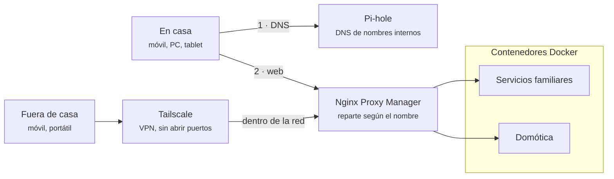

# Despliegue del servidor doméstico

Stacks de Docker Compose del servidor de casa y documentación para usarlos. El servidor clona este repositorio y despliega cada carpeta de `stacks/` como un proyecto de Docker Compose. Los servicios se van añadiendo uno a uno; los que ya están figuran en el [catálogo](docs/catalogo-servicios.md).

No incluye a propósito IPs, puertos ni credenciales.

## Visión general

Todo el tráfico web entra por Nginx Proxy Manager, y ningún servicio está expuesto directamente a Internet: desde fuera de casa se entra por Tailscale.

El dispositivo pregunta primero a Pi-hole por el nombre del servicio y después manda la petición a Nginx Proxy Manager, que la reenvía al contenedor que corresponde.

## Índice

| Documento | Contenido |
| --- | --- |
| [Componentes](docs/componentes.md) | Qué hace cada pieza de la infraestructura |
| [Flujos de acceso](docs/flujos-acceso.md) | Cómo llega una petición, desde casa y desde fuera |
| [Operación](docs/operacion.md) | Cómo se despliega, actualiza y vuelve atrás |
| [Alta de un servicio](docs/alta-servicio.md) | Pasos para publicar un contenedor nuevo |
| [Catálogo de servicios](docs/catalogo-servicios.md) | Servicios desplegados |
